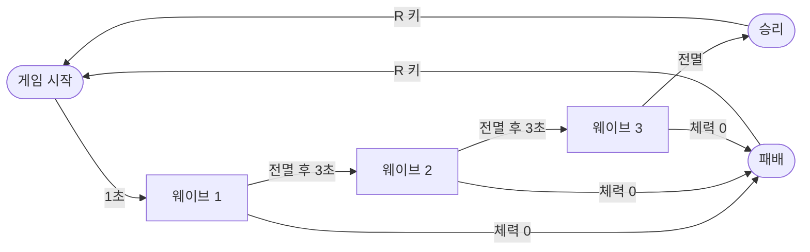

# 쿼터뷰 핵앤슬래시 PRD

## 1. 개요

쿼터뷰 시점에서 마법사 한 명이 풀밭에 몰려오는 적 3종을 근접 공격, 매직 미사일, 순간이동으로 상대하며 3개 웨이브를 버티는 미니 핵앤슬래시 게임이다. 한 판은 3~5분, 처음부터 끝까지 수업 안에서 완성할 수 있는 크기를 목표로 한다.

- 목적: 바이브 코딩 강의 실습용. 이동, 공격 판정, 투사체, 적 AI, 웨이브, UI라는 액션 게임의 기본 부품을 하나씩 만들어 보게 한다.
- 엔진: Godot 4 + GDScript, 3D 씬에 직교(Orthographic) 카메라로 쿼터뷰를 만든다. 기본 도형과 색만 쓰므로 그림 에셋이 없어도 된다.
- 설계 원칙: 기능은 적게, 손맛은 분명하게. 마나·아이템·레벨업 없이 쿨다운만으로 전투를 굴린다. 모든 공격은 마우스 커서 방향으로 나가고 타깃 지정은 없다.
- 열린 질문: 수강 대상(청소년 게임 아카데미아 / 성인 비개발자)과 총 수업 시간에 따라 구현 단계를 몇 회차로 나눌지 정해야 한다.

## 2. 핵심 게임플레이 루프

한 판은 웨이브 3개로 이뤄진다. 적을 전부 잡으면 3초 쉬고 다음 웨이브가 오고, 3웨이브를 넘기면 승리, 체력이 0이 되면 패배다.



전투는 "피하고, 때리고, 빠진다"의 반복이다. 근거리 적은 근접 공격으로 밀어내고, 원거리 적은 미사일로 처리하고, 덩치의 경고 원이 뜨면 순간이동으로 빠진다.

| 웨이브 | 근거리 | 원거리 | 덩치 | 합계 |
| --- | --- | --- | --- | --- |
| 1 | 6 | 0 | 0 | 6 |
| 2 | 6 | 3 | 0 | 9 |
| 3 | 6 | 4 | 2 | 12 |

- 적은 한꺼번에 나오지 않고 0.5초 간격으로 하나씩 스폰된다. 종류는 웨이브 안에서 섞어 내보내고, 게임 시작 1초 뒤에 첫 웨이브가 시작된다.
- 창 크기는 기본 뷰포트 1152×648의 2배인 2304×1296(project.godot의 window_*_override). UI는 뷰포트 기준으로 같이 커진다.
- 재시작은 R 키로 Main 씬을 다시 불러오는 방식으로 처리한다.

## 3. 플레이어 캐릭터

캐릭터는 마법사 한 명이고, 마우스 좌클릭이나 WASD로 걷고 나머지 세 동작은 모두 커서 방향으로 즉시 발동한다. 마나는 없고 각 동작은 쿨다운으로만 제한한다.

| 동작 | 입력 | 효과 | 수치 | 쿨다운 |
| --- | --- | --- | --- | --- |
| 이동 | 좌클릭(누르고 있으면 계속 따라감) 또는 WASD | 클릭한 바닥 지점으로 걸어감, WASD는 화면 기준 방향으로 누르는 동안 걸어감, 나무에 부딪히면 미끄러지듯 비켜감 | 속도 5 m/s | 없음 |
| 근접 공격 | 우클릭 | 커서 방향 부채꼴 범위의 적 전부에게 피해 + 넉백 | 피해 20, 사거리 1.8 m, 각도 90°, 넉백 1 m | 0.4초 |
| 매직 미사일 | Q | 커서 방향으로 직선 투사체 발사, 처음 맞은 적 하나에 피해 후 소멸, 나무에 막힘 | 피해 15, 속도 12 m/s, 최대 12 m | 0.6초 |
| 순간이동 | Space | 커서 방향으로 짧게 순간이동, 도착 직후 잠깐 무적 | 최대 4 m, 무적 0.3초 | 3초 |

- 체력: 100. 회복 수단은 없다(체력 구슬은 확장 과제).
- 피격: 피해를 받으면 0.5초 무적 + 몸이 깜빡인다. 연속 피격으로 한순간에 녹는 것을 막는다.
- 공격 중 이동: 근접 공격과 미사일은 발동하는 순간 이동을 멈추고 커서 쪽으로 몸을 돌린 뒤 0.15초 제자리에 선다. 클릭 이동은 다음 좌클릭으로 다시 걷고(누르고 있던 좌클릭은 무시), WASD는 누르고 있으면 0.15초 뒤 바로 다시 걷는다. 우클릭을 누르고 있으면 쿨다운마다 근접 공격이 반복된다.
- WASD 이동: 쿼터뷰라 월드 축이 아니라 화면 기준이다(W = 화면 위쪽, D = 화면 오른쪽). 카메라 방향에서 계산하고, WASD를 누르면 진행 중인 클릭 이동 목표는 취소된다.
- 장애물: 나무에 정면으로 부딪혀 미끄러질 방향이 없으면 옆으로 살짝 틀어 비켜간다. 맵 밖을 클릭하면 목표를 맵 안쪽으로 잘라 벽 앞에서 멈춘다.
- 순간이동 도착점: 커서가 4 m보다 멀면 4 m 지점, 가까우면 커서 지점. 도착점이 나무나 맵 밖이면 발동하지 않고 쿨다운도 소모하지 않는다. 도착점 검사는 플레이어 몸(캡슐) 모양을 그 자리에 놓아 나무·벽과 겹치는지로 판단하므로, 나무 너머로 건너뛰는 것은 된다. 순간이동하면 진행 중인 클릭 이동은 취소되고 이동한 방향을 바라본다.
- 입력 반복: 우클릭과 Q는 누르고 있으면 쿨다운마다 반복 발동하고, Space는 누를 때마다 한 번만 발동한다.
- 매직 미사일은 몸 중심에서 0.5 m 앞, 높이 1 m에서 나온다.
- 외형: 파란색 캡슐 + 진행 방향을 보여주는 작은 앞쪽 표시(코 역할의 상자).

## 4. 적 3종

적은 근거리, 원거리, 덩치 세 종류이고, 모두 공격 전에 색이 바뀌는 예비 동작을 보여줘서 플레이어가 보고 피할 수 있게 한다. 길찾기는 쓰지 않고 플레이어 쪽으로 곧장 움직이며, 나무에는 미끄러지듯 비켜간다.

| 종류 | 외형 | 체력 | 이동 속도 | 행동 | 공격 | 넉백 |
| --- | --- | --- | --- | --- | --- | --- |
| 근거리(졸개) | 빨간 작은 캡슐 | 30 | 3.5 m/s | 플레이어에게 곧장 달려듦 | 1.2 m 안에 들면 0.3초 예비 동작 후 피해 10, 1초 간격 | 받음 |
| 원거리(궁수) | 주황 캡슐 | 20 | 2.5 m/s | 플레이어와 7~9 m 거리 유지, 가까우면 물러나고 멀면 다가옴 | 0.5초 조준 후 투사체 1발, 피해 8, 속도 7 m/s, 2초 간격, 나무에 막힘 | 받음 |
| 덩치 | 보라 큰 캡슐(2배 크기) | 150 | 1.8 m/s | 느리게 쫓아옴 | 2 m 안에 들면 0.8초 동안 바닥에 빨간 원 표시 후 반경 2.5 m 내려찍기, 피해 25 | 안 받음 |

- 공통 상태: 추적 → 예비 동작 → 공격 → 대기, 그리고 체력 0이면 사망. 상태 머신 하나로 세 종류를 모두 표현한다.
- 피격 반응: 0.1초 흰색 깜빡임. 머리 위에 작은 체력 바. 넉백으로 밀려나면 하던 예비 동작이 끊기고 추적으로 돌아간다.
- 헛치기: 예비 동작이 끝나는 순간 플레이어가 공격 범위 밖이면 빗나간다(근거리는 1.6 m). 예비 동작을 보고 걸어서 빠지면 피할 수 있어야 한다.
- 플레이어가 쓰러지면 모든 적은 공격을 멈추고 제자리에 선다.
- 사망: 0.3초 동안 작아지며 사라짐. 아이템 드롭 없음.
- 궁수 구현 메모: 플레이어와 min_distance(7 m) − 1 m = 6 m보다 가까우면 쏘지 않고 먼저 물러난다(가까운 채로는 제자리에서 계속 쏘기만 해서 거리 유지가 안 됐다). 화살은 조준이 끝나는 순간의 플레이어 방향으로 직선으로 날아가고(몸 앞 0.5 m, 높이 0.8 m에서 출발), 최대 20 m를 날거나 나무·벽에 닿으면 사라진다. 그래서 움직이거나 순간이동하면 피할 수 있다.
- 덩치 구현 메모: 공격 간격 2.5초. 경고 원은 반경 2.5 m 전체를 옅게 깔고, 안쪽 원이 0.8초 동안 차올라 떨어지는 때를 보여준다. 원 밖에 있으면 맞지 않는다.
- 체력 바: 빌보드 Sprite3D 두 장(공유 텍스처)이고, 처음엔 숨겨 두었다가 첫 피해를 입은 뒤부터 보인다(§6).
- 역할 분담: 근거리는 압박, 원거리는 회피 연습, 덩치는 순간이동으로 빠지는 연습을 시키는 적이다.

## 5. 맵과 카메라

맵은 40 m × 40 m 평평한 풀밭 하나에 나무 12그루를 손으로 배치한 고정 맵이고, 카메라는 45° 내려다보는 직교 시점으로 플레이어를 따라간다.

- 바닥: 초록색 평면 40 × 40 m. 가장자리에 보이지 않는 벽 4개.
- 나무: 갈색 원기둥 줄기 + 초록 원뿔 잎. 충돌은 줄기 원기둥(반지름 0.5 m)만. 랜덤 배치 없이 에디터에서 직접 놓아 수업마다 같은 맵을 쓴다. 중앙 반경 6 m 안에는 두지 않는다.
- 플레이어 시작 위치: 맵 중앙.
- 적 스폰: 맵 가장자리 안쪽 스폰 지점 8곳 중 플레이어와 10 m 이상 떨어진 곳에서 무작위로 나온다.
- 카메라: Camera3D, Orthographic, size 약 20. 회전 X −45°, Y 45°(전통적인 쿼터뷰 대각선 시점). 플레이어 위치를 부드럽게 따라감(lerp).
- 클릭 지점 계산: 카메라에서 마우스 위치로 광선을 쏴 바닥 평면(y = 0)과 만나는 점을 구한다. 이동, 공격 방향, 순간이동 모두 이 점을 쓴다.
- 조명: DirectionalLight3D 하나 + 그림자. 그림자가 있어야 쿼터뷰에서 높이감이 산다.

## 6. UI/HUD와 피드백

화면에는 체력, 스킬 쿨다운, 웨이브 정보만 띄우고, 나머지 정보는 색 변화와 짧은 연출로 전달한다.

| 요소 | 위치 | 내용 |
| --- | --- | --- |
| 체력 바 | 왼쪽 아래 | 빨간 바 + "72 / 100" 숫자 |
| 스킬 슬롯 3칸 | 아래 가운데 | 우클릭 · Q · Space 아이콘(글자로 대신해도 됨), 쿨다운 중엔 어둡게 + 남은 초 표시 |
| 웨이브 표시 | 위 가운데 | "웨이브 2 / 3 · 남은 적 7" |
| 웨이브 안내 | 화면 가운데 | 웨이브 시작 시 "웨이브 2" 1.5초 표시 |
| 적 체력 바 | 각 적 머리 위 | 작은 바, 피해를 입은 적만 표시 |
| 결과 화면 | 화면 가운데 | "승리!" 또는 "쓰러졌다…", 처치 수, 걸린 시간, "R 키로 다시 시작" |

- 클릭 표시: 좌클릭한 바닥에 작은 원이 0.3초 나타났다 사라진다.
- 근접 공격: 부채꼴 모양 반투명 이펙트 0.1초.
- 매직 미사일: 밝은 하늘색 작은 구. 맞으면 작게 퍼지는 효과.
- 순간이동: 출발점과 도착점에 짧은 파란 원.
- 플레이어 사망: 캐릭터가 회색으로 변하며 옆으로 눕고, 1초 뒤 결과 화면이 뜬다. 마지막 적을 잡으면 0.6초 뒤 승리 화면이 뜬다.
- 플레이어 피격: 캐릭터 깜빡임 + 화면 가장자리 빨간 비네트 0.2초.

## 7. 기술 스펙

Godot 4.x, GDScript, 3D 씬 하나에 씬 파일 9개로 구성한다(장식용 Chest.tscn은 구현 중 사용자 요청으로 추가해 실제로는 10개). 적 세 종류는 공통 스크립트 하나를 상속해 차이점만 덮어쓴다.

씬 구조:

```
Main.tscn
├─ World (Node3D)
│  ├─ Ground (StaticBody3D + 40×40 Plane)
│  ├─ Walls (StaticBody3D × 4, 보이지 않음)
│  ├─ Trees (Node3D) ─ Tree.tscn × 12
│  ├─ Chest (Chest.tscn) ─ 보물상자, 플레이어가 가까이 오면 열림 (장식, 보상 없음)
│  ├─ SpawnPoints (Node3D) ─ Marker3D × 8
│  └─ Sun (DirectionalLight3D)
├─ Player.tscn (CharacterBody3D)
├─ CameraRig (Node3D) ─ Camera3D (직교)
├─ Enemies (Node3D)   ← 스폰된 적이 들어가는 곳
├─ Projectiles (Node3D) ← 미사일·화살이 들어가는 곳
├─ WaveManager (Node)
└─ HUD.tscn (CanvasLayer)

Enemy.gd (CharacterBody3D 공통: 체력, 상태 머신, 피격, 사망)
├─ MeleeEnemy.tscn
├─ RangedEnemy.tscn
└─ BruteEnemy.tscn
MagicMissile.tscn (Area3D)
EnemyArrow.tscn (Area3D)
```

충돌 레이어:

| 번호 | 이름 | 들어가는 것 | 감지 대상 |
| --- | --- | --- | --- |
| 1 | world | 땅, 벽, 나무 | 없음 |
| 2 | player | 플레이어 | world |
| 3 | enemy | 적 3종 | world, player, enemy |
| 4 | player_attack | 매직 미사일, 근접 판정 | world, enemy |
| 5 | enemy_attack | 화살, 내려찍기 판정 | world, player |

입력 맵: move(마우스 좌), move_up/move_down/move_left/move_right(W/S/A/D), attack_melee(마우스 우), cast_missile(Q), teleport(Space), restart(R).

- 이동: Player는 목표 지점을 저장하고 매 프레임 그쪽으로 velocity를 주어 move_and_slide(). 0.2 m 안으로 들어오면 멈춤.
- 근접 판정: 사거리 안의 적 중 플레이어 정면과의 각도가 45° 이내인 적을 골라 피해(Area3D 없이 거리·각도 계산만으로 처리).
- 피해 전달: 공격하는 쪽이 대상의 take_damage(amount, from_position)을 호출한다. 플레이어와 적이 같은 이름의 함수를 갖는다.
- 신호: Player.died, Player.health_changed, Enemy.died, WaveManager.wave_started, WaveManager.remaining_changed(남은 적 수가 바뀔 때), WaveManager.all_waves_cleared. HUD와 결과 화면은 신호만 듣는다.
- WaveManager: 웨이브 구성표는 `waves`(Array[Vector3i], 근거리·원거리·덩치 마릿수)로 인스펙터에서 바꾼다. 처치 수(kills)와 경과 시간(elapsed)도 갖고 있어 결과 화면이 읽는다.
- HUD: HUD.tscn은 CanvasLayer 하나이고, 체력 바·스킬 칸·웨이브 표시·안내 문구·비네트(셰이더 하나)·결과 화면은 HUD.gd가 코드로 만든다. 한글은 시스템 폰트로 표시된다. R 키 재시작(reload_current_scene)도 여기서 처리한다.
- 수치 관리: 모든 수치는 각 스크립트 맨 위 @export 변수로 두어 인스펙터에서 바로 조정한다.
- 보물상자: `export/chest.glb`(Blender에서 직접 제작, AnimationPlayer에 `open` 애니메이션 포함)를 Chest.tscn이 인스턴스한다. TriggerArea(Area3D, 레이어 없음, 마스크 = player, 반지름 2 m)에 플레이어가 들어오면 `open`을 한 번 재생하고 열린 채로 둔다. 다시 접근해도 재생하지 않는다. 충돌체가 없어 플레이어가 통과한다. 아이템·골드 드롭은 §8에 따라 넣지 않았다.
- 움직임 처리: 물리 보간(physics_interpolation)을 켠다. 120 Hz 화면에서 60 Hz 물리를 부드럽게 보이게 하기 위해서다. 그래서 움직이는 것은 카메라까지 모두 _physics_process에서 움직인다. 순간이동처럼 위치가 한 번에 바뀌면 reset_physics_interpolation()을 호출한다. 플레이어와 적은 CharacterBody3D의 Floating 모드(중력 없음, y = 0 고정)를 쓴다.
- 이펙트 끊김 방지: 클릭 원, 부채꼴 같은 이펙트의 메시·머티리얼은 한 번만 만들어 재사용하고, 사라지는 효과는 인스턴스별 transparency로 준다. 이펙트마다 새로 만들면 그 프레임이 60~90 ms 멈춰 화면이 흔들려 보인다. 처음 그릴 때의 셰이더 컴파일 멈춤은 게임 시작 때 안 보이는 곳에 한 번 그려 미리 없앤다.
- 에셋: 전부 Godot 기본 메시(Capsule, Cylinder, Cone, Sphere, Plane)와 StandardMaterial3D 색으로 만든다. 외부 에셋·사운드 없음.

## 8. 범위 밖

아래 항목은 만들지 않는다. AI에게 작업을 맡길 때도 이 목록을 함께 주어 기능이 불어나지 않게 한다.

- 점프, 구르기, 달리기
- 마나, 경험치, 레벨업, 스킬 트리
- 아이템, 인벤토리, 장비, 골드, 드롭
- 두 번째 캐릭터나 직업 선택
- 내비게이션 메시 길찾기
- 여러 맵, 던전, 맵 자동 생성
- 캐릭터 모델·애니메이션 리깅, 외부 에셋
- 사운드와 음악
- 저장/불러오기, 메인 메뉴, 설정 화면
- 미니맵, 퀘스트, 대화, NPC
- 멀티플레이

## 9. 구현 단계 Todo

8단계로 나누고, 각 단계는 끝나면 바로 실행해서 눈으로 확인할 수 있는 상태로 끝난다. 한 단계씩 AI에게 맡기고 확인 기준을 통과하면 다음으로 넘어간다.

1단계. 프로젝트와 맵

- [x] 1.1 Godot 4 프로젝트 생성, 충돌 레이어 5개 이름 지정, 입력 맵 등록
- [x] 1.2 Main.tscn에 40×40 바닥, 보이지 않는 벽 4개, 조명 배치
- [x] 1.3 Tree.tscn 제작 후 12그루 손으로 배치
- [x] 1.4 직교 카메라(X −45°, Y 45°) 설정

* 확인: 실행하면 쿼터뷰로 풀밭과 나무가 보인다.

2단계. 플레이어 이동

- [ ] 2.1 Player.tscn(파란 캡슐 + 앞쪽 표시) 제작
- [ ] 2.2 마우스 광선으로 바닥 클릭 지점 계산, 클릭 표시 원
- [ ] 2.3 클릭 지점으로 이동, 누르고 있으면 계속 따라감, 이동 방향으로 회전
- [ ] 2.4 카메라가 플레이어를 부드럽게 따라감
- [ ] 2.5 WASD로 화면 기준 방향 이동

* 확인: 클릭한 곳으로 걸어가거나 WASD로 걷고, 나무에 막히면 비켜간다.

3단계. 근접 공격과 적 하나

- [ ] 3.1 Enemy.gd 공통 스크립트(체력, take_damage, 깜빡임, 사망)
- [ ] 3.2 MeleeEnemy.tscn: 플레이어 추적 + 예비 동작 후 공격
- [ ] 3.3 플레이어 체력, take_damage, 피격 무적 0.5초
- [ ] 3.4 우클릭 근접 공격(거리·각도 판정, 넉백, 부채꼴 이펙트)

* 확인: 맵에 둔 졸개 하나를 근접 공격으로 잡을 수 있고, 맞으면 내 체력이 준다.

4단계. 매직 미사일과 순간이동

- [ ] 4.1 MagicMissile.tscn: 직진, 적에 맞으면 피해 후 소멸, 나무에 막힘, 12 m 후 소멸
- [ ] 4.2 Q로 커서 방향 발사, 쿨다운 0.6초
- [ ] 4.3 Space 순간이동: 최대 4 m, 도착점 검사, 무적 0.3초, 쿨다운 3초

* 확인: 세 가지 동작을 섞어 졸개 여러 마리를 상대할 수 있다.

5단계. 원거리·덩치 적

- [ ] 5.1 RangedEnemy.tscn: 거리 유지 이동 + EnemyArrow 발사
- [ ] 5.2 BruteEnemy.tscn: 바닥 경고 원 0.8초 후 범위 내려찍기, 넉백 무시
- [ ] 5.3 적 머리 위 체력 바

* 확인: 화살은 순간이동이나 나무 뒤로 숨어 피할 수 있고, 덩치의 빨간 원 밖으로 나가면 안 맞는다.

6단계. 웨이브

- [ ] 6.1 WaveManager: 웨이브 구성표대로 스폰 지점에서 적 생성
- [ ] 6.2 전멸 감지 후 3초 쉬고 다음 웨이브, 3웨이브 클리어 시 승리 신호

* 확인: 웨이브 1~3이 순서대로 나오고 마지막 적을 잡으면 승리 신호가 나간다.

7단계. HUD와 결과 화면

- [ ] 7.1 체력 바, 스킬 쿨다운 3칸, 웨이브 표시(3단계에서 확인용으로 넣은 임시 체력 표시 DebugHud는 지운다)
- [ ] 7.2 웨이브 시작 안내 문구
- [ ] 7.3 승리/패배 결과 화면, R로 재시작

* 확인: 처음부터 끝까지 한 판을 플레이하고 다시 시작할 수 있다.

8단계. 손맛 다듬기

- [ ] 8.1 피격 깜빡임, 화면 빨간 비네트, 사망 연출 점검
- [ ] 8.2 3명 이상 플레이 테스트 후 수치 조정(목표: 처음 하는 사람이 2~3번 만에 클리어) — 사람 테스트는 아직 안 함. 참고: 피하지 않고 근접만 휘두르는 자동 봇은 1·2웨이브를 넘기고 3웨이브(덩치)에서 쓰러졌다.

* 확인: 한 판 3~5분, 막히는 웨이브가 3웨이브 하나뿐이다.

## 10. 완료 기준과 확장 과제

처음 해보는 사람이 설명 없이 조작을 익혀 3웨이브를 끝까지 플레이하고 R로 다시 시작할 수 있으면 완성이다.

완료 기준:

- [ ] 좌클릭 이동, 우클릭 근접, Q 미사일, Space 순간이동이 모두 커서 방향으로 동작한다.
- [ ] 적 3종이 표의 수치와 행동대로 움직이고, 공격 전 예비 동작이 눈에 보인다.
- [ ] 웨이브 3개가 이어지고 승리·패배·재시작이 된다.
- [ ] 60 fps에서 적 15마리가 동시에 있어도 끊기지 않는다.
- [ ] 모든 수치를 인스펙터에서 코드 수정 없이 바꿀 수 있다.

확장 과제(수강생 개별 과제용, 하나씩 독립적으로 붙일 수 있는 것):

- 체력 구슬: 적이 25% 확률로 떨어뜨리고 밟으면 체력 20 회복
- 피해 숫자가 떠오르는 효과, 타격 순간 0.05초 멈춤(히트스톱), 카메라 흔들림
- 효과음 3개(공격, 피격, 순간이동)
- 4웨이브 보스: 덩치를 키우고 원거리 공격을 섞은 적
- 무료 에셋(예: Kenney)으로 캡슐을 캐릭터 모델로 교체
- 기록 표시: 최단 클리어 시간
